# Relayflow - Workflow Automation Builder

Relayflow is a frontend-only workflow automation workspace for designing, testing, and managing repeatable business processes. Its visual editor lets you arrange triggers and steps, configure sample inputs, and preview a run without connecting to external services.

## Pages

- **Workflows** (`/workflows`) - Review workflow status and recent runs. Search, sort, create, duplicate, pause, activate, open, or delete workflows.
- **Builder** (`/builder/:workflowId`) - Edit a workflow name and its trigger, condition, action, and wait steps. Add and reorder steps, update their fields, save, run a sample test, and publish or pause the workflow.
- **Templates** (`/templates`) - Search and filter starter workflows, preview their steps, and create a draft from a template.
- **Run history** (`/runs`) - Search and filter sample run records, inspect run details, retry a sample run, and export the visible records as CSV.
- **Not found** - A friendly page for unknown routes, with navigation back to the workspace.

## Using the demo

Start in **Workflows** to open an existing flow or create a new one. The builder has a step palette and editable flow canvas. Add and reorder steps, edit their configuration, then save or run a sample test. Published and paused states update the workflow list. Templates create editable drafts, and the run history reflects sample tests performed during the current session.

All workflow and run records are seeded demo data held in React state in memory. There is no backend, external automation, account system, or browser storage. Test runs use sample data and do not call connected services. Changes remain available while navigating this app session and reset when the page is refreshed.

Destructive actions use an in-app confirmation dialog. Forms provide validation, and workflow actions show toast feedback. The editor adapts to narrow screens and keeps its step palette available while working.

## Screenshots

The gallery below shows the built app with representative demo data. Mobile screenshots use a narrow viewport.

### Pages

| Page | Preview |
| --- | --- |
| Workflows | 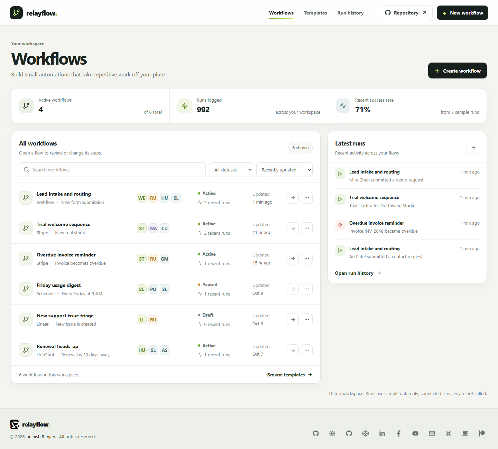 |
| Workflow builder | 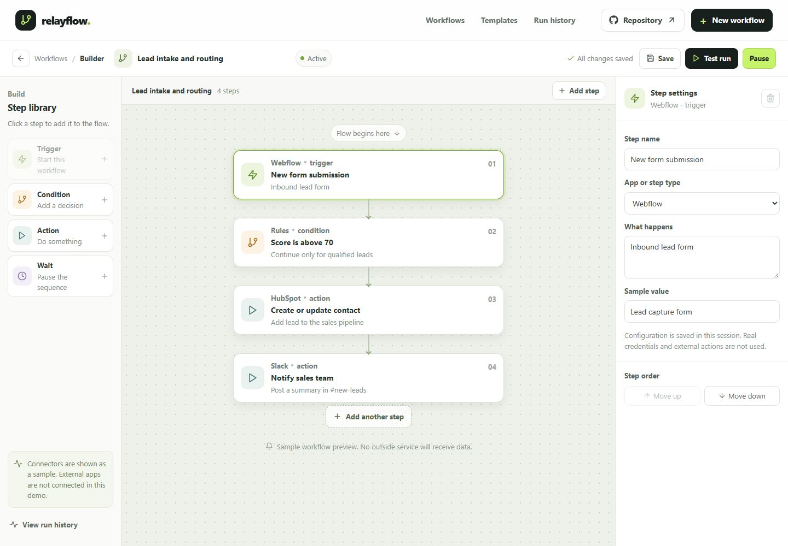 |
| New workflow draft | 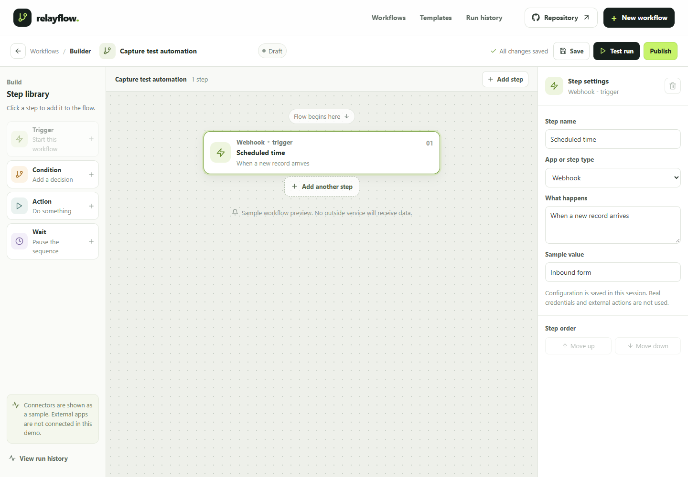 |
| Templates | 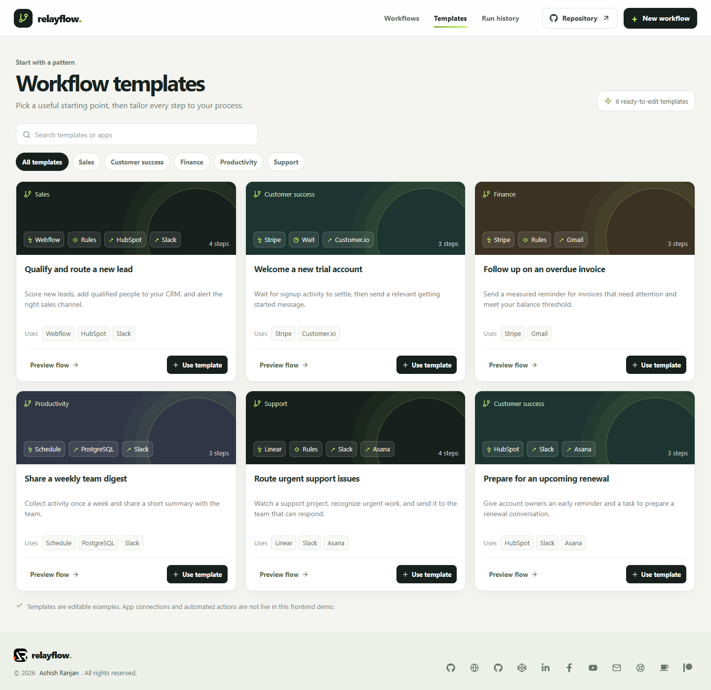 |
| Run history | 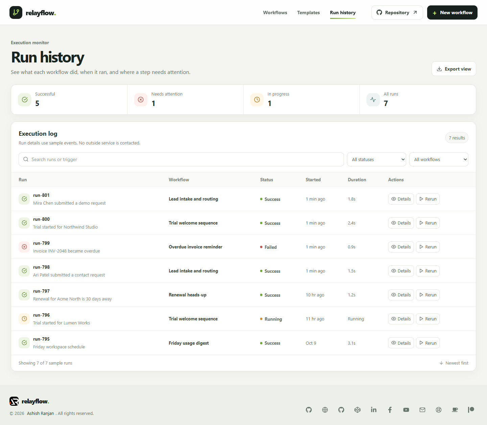 |
| Not found | 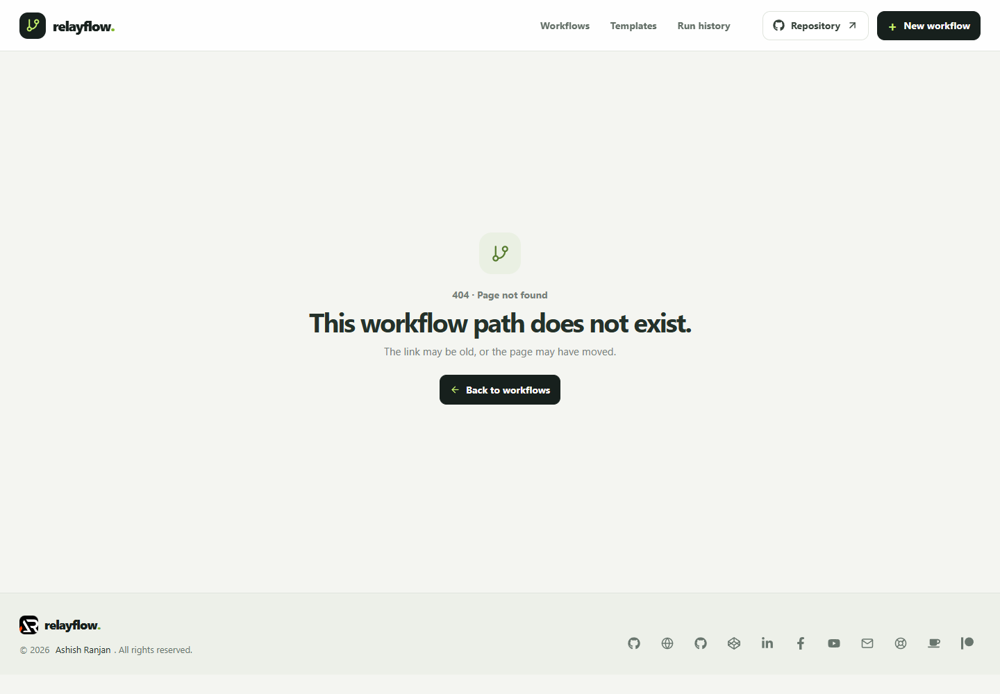 |
| Workflows on mobile | 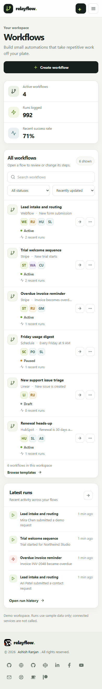 |
| Builder on mobile | 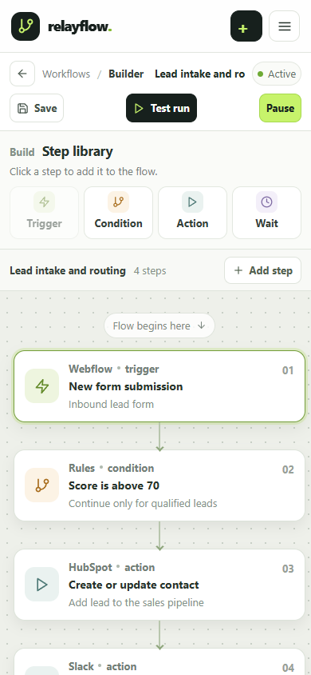 |

### Dialogs

| Dialog | Preview |
| --- | --- |
| Create workflow | 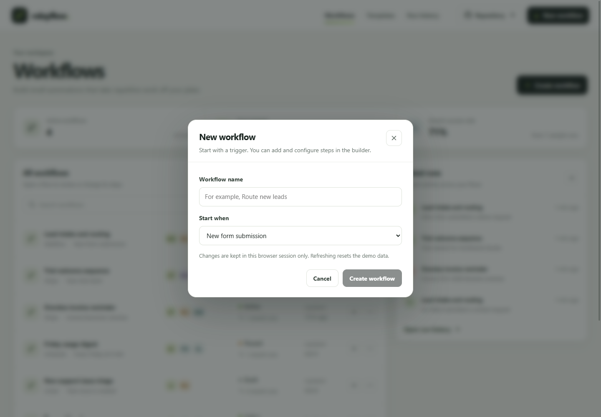 |
| Template preview | 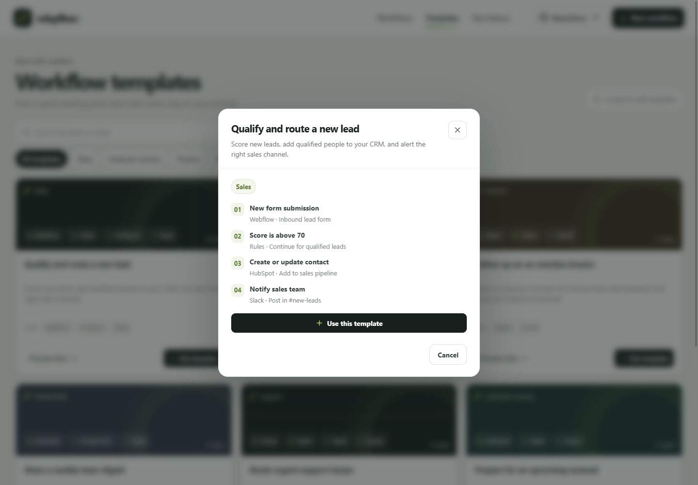 |
| Run details | 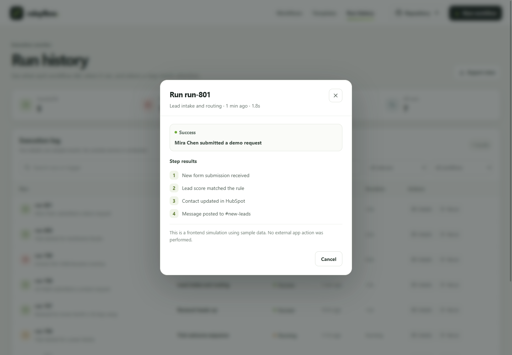 |
| Remove step confirmation | 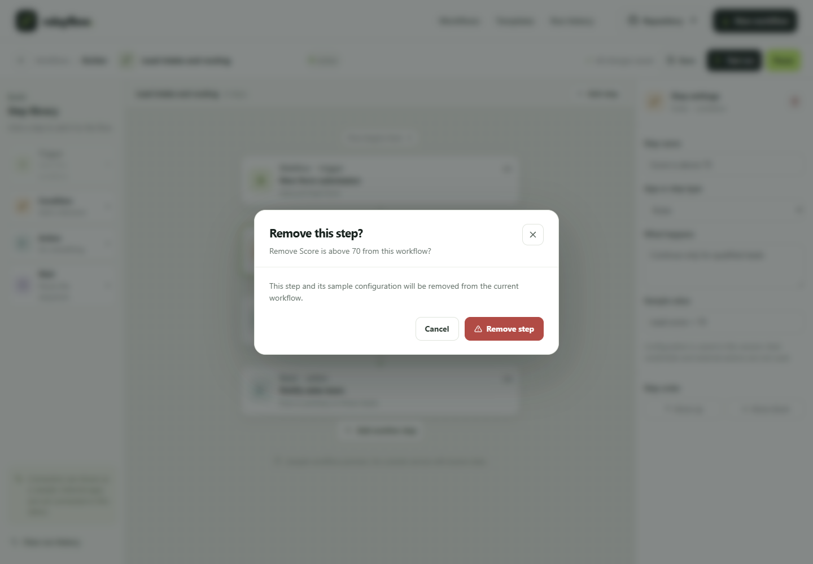 |
| Delete workflow confirmation | 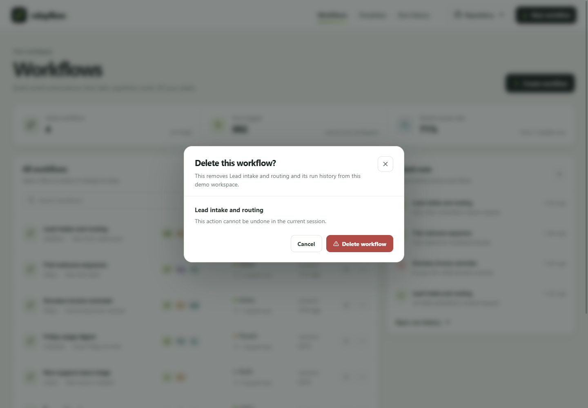 |

## Run locally

Requirements: Node.js and npm.

```sh
npm install
npm run dev
```

Useful checks:

```sh
npm run lint
npm run build
npm run preview
```

## Deployment

The app is live on [GitHub Pages](https://a2rp.github.io/workflow-automation-builder/). GitHub Pages serves the `gh-pages` branch from its root. The project base path and `npm run deploy` script are configured for this repository. The script builds the app, copies the entry page to `404.html` for SPA route fallback, and publishes `dist` with `gh-pages`.

The deployment was checked after publishing: the home page, JavaScript bundle, stylesheet, favicon, footer logo, and social preview image returned successfully. A direct `/workflows` request returns the custom `404.html` app entry so the client router can render the route on refresh. To publish later source updates, run:

```sh
npm run deploy
```

## Future improvements

These features need server-side services or real third-party integrations and are not implemented in this frontend demo:

- Shared workflows and run history across devices, backed by an API and database.
- Team workspaces, user accounts, roles, and workflow permissions.
- Live connections to business apps, webhooks, and scheduled job execution.
- Server-side execution logs, audit history, retries, and operational alerts.
- Securely stored credentials and access controls for connected services.

## Links

- Portfolio: [https://www.ashishranjan.net](https://www.ashishranjan.net)
- GitHub: [https://github.com/a2rp](https://github.com/a2rp)
- CodePen: [https://codepen.io/ash1198](https://codepen.io/ash1198)
- LinkedIn: [https://www.linkedin.com/in/aashishranjan](https://www.linkedin.com/in/aashishranjan)
- Facebook: [https://www.facebook.com/theash.ashish/](https://www.facebook.com/theash.ashish/)
- YouTube: [https://www.youtube.com/@ashishranjan-ashz?sub_confirmation=1](https://www.youtube.com/@ashishranjan-ashz?sub_confirmation=1)
- Email: [mailto:ash.ranjan09@gmail.com](mailto:ash.ranjan09@gmail.com)

## Support

- Support: [https://a2rp-donation-page.netlify.app/](https://a2rp-donation-page.netlify.app/)
- Buy Me a Coffee: [https://buymeacoffee.com/ashishranjan](https://buymeacoffee.com/ashishranjan)
- Patreon: [https://www.patreon.com/ashishranjan](https://www.patreon.com/ashishranjan)
